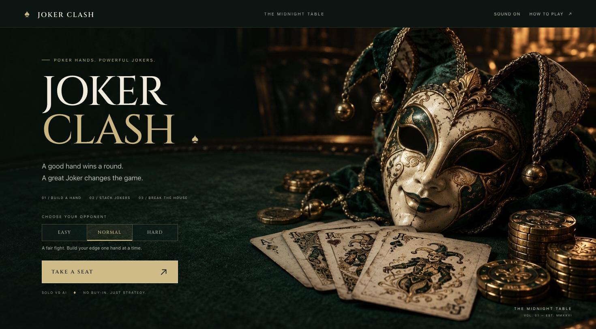

# Joker Clash — The Midnight Table

A solo poker-hand card battler. Build a hand, draft permanent Jokers, and take the House from 150 HP to zero. Vanilla HTML, CSS, and JavaScript; no build step or service required.



## Play locally

```sh
python3 -m http.server 8765 --bind 127.0.0.1
```

Open http://127.0.0.1:8765 in a browser. Select a difficulty and **Take a seat**. The header's **How to play** opens the rules and scoring reference.

- Select 1–5 cards from your 8-card hand. Every play/discard refills your hand.
- Four plays and three discards per turn, before Joker bonuses.
- Score is `(base hand chips + card chips + Joker chips) × multiplier × Joker multipliers`.
- Damage is score divided by 95, rounded up; armor absorbs damage first.
- A score of 160+ grants a Joker draft once per turn. Five slots maximum; the next pick replaces the oldest.
- Easy makes more mistakes and starts without a Joker. Normal and Hard start with one Joker; Hard chooses its strongest hands.

Keyboard: **1–8** selects cards, **H** chooses the best hand, **Enter/Space** plays when focus is outside a control, and **Escape** clears selection. Buttons and cards also support Tab and native Enter/Space activation. Sound preference persists locally. Motion follows the system's reduced-motion preference.

## Presentation and media

The Midnight Table pass adds emerald felt, brass edging, an illustrated title scene, 52 ivory SVG card faces, an engraved card back, two player crests, and 28 matching Joker seals. The original scoring engine remains unchanged.

- [Gameplay footage](media/joker-clash-gameplay.mp4) — 36 seconds of actual UI-driven play; silent, captured at 12 fps and encoded at 24 fps. Cards and scores were not injected.
- [Desktop battle](media/joker-clash-table.png) — staged Royal Flush preview, explicitly separate from gameplay footage.
- [Mobile battle](media/joker-clash-mobile.png) — normal match at 390 × 844.
- [Joker draft](media/joker-clash-draft.png) — real earned reward.
- [Artwork provenance and generation prompt](media/ASSET-NOTES.md).

`?shot=1` opens a staged screenshot composition. It is a presentation aid, not a saved match or balanced starting state.

## Checks

```sh
node --check js/game.js
node test/logic.test.js
```

The 31 existing logic checks cover hand detection, scoring, Jokers, decks, AI, and damage. They were recovered from the original local card-battle source and included here so the repository can run them directly. Browser validation for this pass is documented in [media/QA.md](media/QA.md).

## Refresh the footage

With the local server running and Ego Browser installed:

```sh
ego-browser nodejs -e 'await import("file:///ABSOLUTE/PATH/TO/joker-clash/tools/capture.mjs")'
ffmpeg -framerate 12 -i .capture/%05d.jpg -c:v libx264 -crf 22 -pix_fmt yuv420p -r 24 -movflags +faststart media/joker-clash-gameplay.mp4
```

The capture script drives normal UI actions for 36 seconds and writes temporary frames under `.capture/` (gitignored). The outcome varies with the shuffled deck. It leaves its browser task space open for inspection; finish that space after your review.

Asset licenses and provenance: [assets/CREDITS.txt](assets/CREDITS.txt). Legacy Kenney PNGs remain in the repository for reference; the active deck and UI use the new SVGs and CSS theme.
